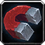

# Item Flow

Loot, sell junk and repair on their own, and buy full stacks with one right-click.

- **Loots** everything at once
- **Sells** your gray items and repairs your gear at vendors
- **Buys** a full stack with one right-click

## Features

- Fast Loot takes every item without opening the loot window, unless you need to act
- Sells your gray items at any vendor and tells you what they earned
- Repairs your gear at repair vendors, from guild funds if you like
- Buy Max Stack: a right-click at a vendor buys a full stack instead of one item
- Turn each feature on or off on its own

## Quick start

1. Turn off any other auto loot addon
2. Turn on Auto Loot in the game's Options under Controls
3. Open a vendor. Your junk sells and your gear repairs on their own
4. Tick **Buy Max Stack** at the top of the vendor window, then right-click what you want
5. Type `/if` or `/itemflow`, or pick Item Flow in the addon menu, to turn each feature on or off

## Commands

`/if`, `/if intro` and `/if help`
