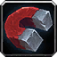

# Item Flow

A WoW Forever addon that loots everything at once, sells your junk, repairs your gear and buys full stacks at vendors.

## Features

- Fast Loot takes every item without opening the loot window, unless you need to act.
- Sells your gray items at any vendor and tells you what they earned.
- Repairs your gear at repair vendors, from guild funds if you like.
- A right-click at a vendor buys a full stack instead of one item.

## Usage

1. Turn off any other auto loot addon.
2. Turn on Auto Loot in the game's Options under Controls.
3. Open a vendor. Your junk sells and your gear repairs on their own.
4. Tick Buy Max Stack at the top of the vendor window, then right-click what you want.
5. Type `/itemflow` or `/if`, or pick Item Flow in the addon menu, to turn each feature on or off.
